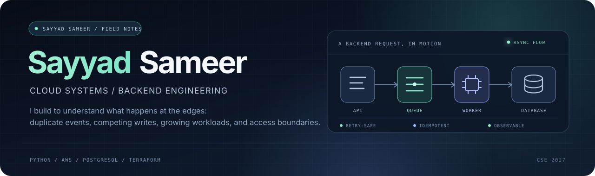

  
   
  
<strong>Cloud & Backend Engineering</strong>

  
Designing, testing, and understanding backend systems — especially where reliability, consistency, performance, and security meet.

  

    <a href="https://sameer-portfolio-phi.vercel.app/">PORTFOLIO</a>
    &nbsp;·&nbsp;
    <a href="https://www.linkedin.com/in/sayyad-sameer-m3/">LINKEDIN</a>
    &nbsp;·&nbsp;
    <a href="mailto:sayyadsameerm3@gmail.com">EMAIL</a>
    &nbsp;·&nbsp;
    <a href="https://www.credly.com/users/sameersayyad.a071ac4c/badges">CREDENTIALS</a>
  

  

    
    
  

---

## What I use this profile for

I am a Computer Science and Engineering student (Class of 2027) interested in cloud-native backend systems. My projects tend to start with practical questions: how should a service behave when an event arrives twice, two writes race, a dataset exceeds available memory, or a workload crosses an account boundary?

## Engineering focus

| Reliability & messaging | Data consistency | Performance & scale | Cloud security |
|:--|:--|:--|:--|
| Idempotency, retries, partial-batch failures, dead-letter queues | Optimistic concurrency, transaction boundaries, deduplication | Streaming I/O, bounded memory, caching, load testing | Least-privilege IAM, cross-account access, KMS, infrastructure checks |

## Selected implementations

The projects below are grouped by the engineering question they explore. The repository is the source of truth for implementation details and current status.

<table>
  <tr>
    <td width="50%" valign="top">
      
01 / DELIVERY & RECOVERY

      <h3><a href="https://github.com/Sayyaddsameer/order_processing_system_with_aws">Event-Driven Order Processing</a></h3>
      
<strong>Question:</strong> What happens when the same order event is delivered more than once?

      
Decoupled order processing with database-backed idempotency, SQS partial-batch failure reporting, and dead-letter routing.

      <code>API Gateway → Lambda → SQS → Lambda → SNS</code> 
      Python · AWS SAM · PostgreSQL
    </td>
    <td width="50%" valign="top">
      
02 / EVENT STREAMING

      <h3><a href="https://github.com/Sayyaddsameer/kafka-eda-aws">Kafka Event Pipeline on AWS</a></h3>
      
<strong>Question:</strong> How should consumers deal with repeated events and distributed processing?

      
Asynchronous producers and consumers on Amazon MSK and ECS Fargate, with PostgreSQL-backed deduplication.

      <code>Producer → MSK → ECS Consumer → PostgreSQL</code> 
      Python · aiokafka · Terraform
    </td>
  </tr>
  <tr>
    <td width="50%" valign="top">
      
03 / DATA CONSISTENCY

      <h3><a href="https://github.com/Sayyaddsameer/ecommerce-order-api">Concurrency-Safe Order API</a></h3>
      
<strong>Question:</strong> How do you prevent simultaneous checkouts from overselling inventory?

      
Optimistic concurrency control with version columns, conflict detection, and retry handling.

      <code>Request → Version Check → Update / Retry</code> 
      FastAPI · SQLAlchemy 2.0 · PostgreSQL · Pytest
    </td>
    <td width="50%" valign="top">
      
04 / STREAMING & MEMORY

      <h3><a href="https://github.com/Sayyaddsameer/data-export-engine">Data Export Engine</a></h3>
      
<strong>Question:</strong> Can large exports run without loading the entire dataset into memory?

      
Server-side database cursors, chunked response streaming, and on-the-fly gzip compression. The test container is capped at 256 MB.

      <code>Cursor → Chunks → Gzip → HTTP</code> 
      Python · FastAPI · asyncpg · Docker
    </td>
  </tr>
  <tr>
    <td width="50%" valign="top">
      
05 / CLOUD SECURITY

      <h3><a href="https://github.com/Sayyaddsameer/CloudSentinel_AI">CloudSentinel AI</a></h3>
      
<strong>Question:</strong> How can cloud risk checks run across accounts and security domains?

      
Multi-cloud security platform with parallel AWS scanners, Step Functions orchestration, cross-account STS AssumeRole, and Terraform modules.

      <code>Orchestrator → Parallel Scanners → Findings</code> 
      Step Functions · Lambda · STS · DynamoDB · Terraform
    </td>
    <td width="50%" valign="top">
      
06 / INFRASTRUCTURE ASSURANCE

      <h3><a href="https://github.com/Sayyaddsameer/fintech-infra">FinTech Compliance Infrastructure</a></h3>
      
<strong>Question:</strong> Can security requirements be expressed as testable infrastructure?

      
Terraform AWS baseline covering least-privilege IAM, customer-managed KMS keys and rotation, S3 public-access controls, and automated Bash checks.

      <code>Terraform → AWS Resources → Audit Checks</code> 
      Terraform · AWS KMS · IAM · S3 · Bash
    </td>
  </tr>
</table>

  
<strong>More implementations</strong>

   
  **[Content Delivery & Origin Shield API](https://github.com/Sayyaddsameer/aws-content-delivery-api)** — ETag-based conditional caching, 304 responses, origin authentication, and load testing.  
  FastAPI · CloudFront · S3 · Locust

  **[Container Orchestration Comparison](https://github.com/Sayyaddsameer/container-orchestration-comparison)** — compares Kubernetes HPA and Docker Swarm under simulated traffic surges.  
  k3s · Kubernetes · Docker Swarm · k6

  **[HireFusion AI](https://github.com/Sayyaddsameer/HireFusionAI)** — serverless recruitment workflow combining document extraction, NLP analysis, and structured candidate data.  
  Lambda · Textract · Comprehend · S3 · DynamoDB

## Live development activity

These cards are generated from the connected public profiles rather than numbers manually written into this README. GitHub's own contribution calendar also appears on the profile page.

  
  

  

## Problem-solving practice

I keep competitive programming alongside project work to stay sharp on data structures, algorithms, and implementation under constraints. The LeetCode card below is dynamically generated; the other profiles link directly to their live records.

  
  

    <a href="https://leetcode.com/u/sayyadsameerm3/">LeetCode</a>
    &nbsp;·&nbsp;
    <a href="https://www.codechef.com/users/sayyadsameer">CodeChef</a>
    &nbsp;·&nbsp;
    <a href="https://codeforces.com/profile/sayyad_sameer">Codeforces</a>
    &nbsp;·&nbsp;
    <a href="https://www.geeksforgeeks.org/user/sayyadsameer/">GeeksforGeeks</a>
    &nbsp;·&nbsp;
    <a href="https://www.hackerrank.com/profile/sayyadsameerm3">HackerRank</a>
  

## How I approach a build

| First, make the flow clear | Then test the boundaries | Finally, leave evidence |
|:--|:--|:--|
| Map requests, events, data ownership, and service boundaries. | Exercise retries, duplicate delivery, concurrent writes, memory limits, and permission failures. | Keep setup reproducible; add tests, measurements, and notes about trade-offs. |

## The path so far

| Period | What I was working on |
|:--|:--|
| **2023** | C programming and structured problem-solving foundations. |
| **2024** | Data structures and algorithms, Java, Python, object-oriented programming, and web fundamentals. |
| **2025** | DBMS, SQL, Linux administration, RHCSA preparation, AWS networking, and infrastructure fundamentals. |
| **2026** | AWS cloud engineering, serverless development, DevOps, distributed backend projects, and multi-cloud security. |

## Recognition

**Best AI Integration — Project Space Season 8 (May 2026)**  
Recognized for CloudSentinel AI at Technical Hub. The event involved 160 teams and more than 900 engineering students.

## Current direction

**Independent Cloud & Backend Development · July 2026 — Present**

I am continuing to build asynchronous Python APIs, event-driven AWS workflows, and containerized services. The area I keep coming back to is reliability: making behavior predictable when messages repeat, dependencies fail, or workloads change.

## Tools I work with

| Area | Technologies |
|:--|:--|
| **Cloud & messaging** | AWS Lambda, Step Functions, API Gateway, SQS, SNS, DynamoDB, S3, RDS, MSK, ECS Fargate, IAM, KMS, STS |
| **Backend & data** | Python, FastAPI, PostgreSQL, SQLAlchemy, asyncpg, Kafka, Pytest |
| **Infrastructure & operations** | Terraform, Docker, Kubernetes, AWS SAM, LocalStack, GitHub Actions, Linux, Bash |
| **Other languages** | Java, C++, C, JavaScript |

## Credentials & academic context

**[AWS Certified Developer – Associate](https://www.credly.com/badges/ac239a82-00c9-4c23-bccd-70e0de189f91/public_url)**  ·  **[Red Hat Certified System Administrator](https://www.credly.com/badges/f2cfa6d9-8f36-46a4-871f-8a6c0ee89f2f/public_url)**  ·  **[Oracle Java Certified Foundations Associate](https://catalog-education.oracle.com/)**  ·  **[Information Technology Specialist — HTML & CSS](https://www.credly.com/badges/71367d89-76ba-4fb4-a26d-b7e2fa17355f/public_url)**

B.Tech, Computer Science & Engineering · Aditya College of Engineering & Technology · Class of 2027 · CGPA 8.69/10

---

  BUILD / BREAK / MEASURE / IMPROVE
    
  <a href="https://github.com/Sayyaddsameer">GitHub</a>
  &nbsp;·&nbsp;
  <a href="https://sameer-portfolio-phi.vercel.app/">Portfolio</a>
  &nbsp;·&nbsp;
  <a href="https://www.linkedin.com/in/sayyad-sameer-m3/">LinkedIn</a>

